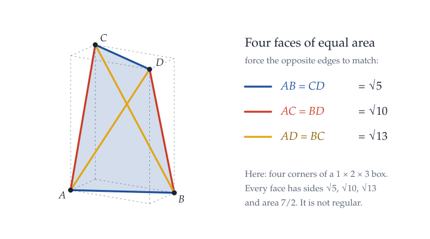
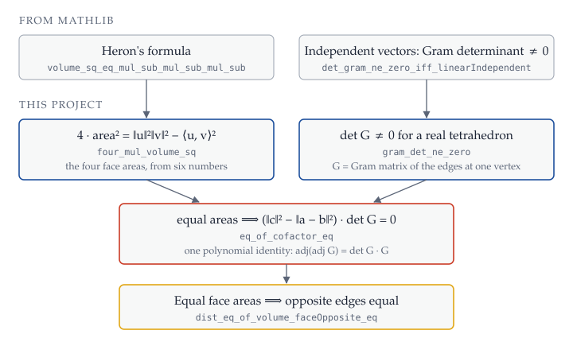

# Bang’s theorem in Lean 4

[](https://github.com/redzwn/bang-lean/actions/workflows/lean.yml)

If the four faces of a tetrahedron have the same area, then its opposite edges are equal in pairs, so the four faces are congruent triangles. This repository proves that in [Lean 4](https://lean-lang.org) with [Mathlib](https://github.com/leanprover-community/mathlib4), together with its converse and a consequence for distance sums.

<p align="center">
  <picture>
    <source media="(prefers-color-scheme: dark)" srcset="assets/bang-dark.svg">
    
  </picture>
</p>

A tetrahedron with opposite edges equal is called a *disphenoid* (also an isosceles or equifacial tetrahedron). The one in the picture is the worked example in [`Bang/Examples.lean`](Bang/Examples.lean).

**A note on the name.** Strictly, *Bang’s theorem on tetrahedra* (A. S. Bang, 1897) is about the inscribed sphere: join its point of tangency on each face to the corners of that face, and the same three angles appear on every face. The statement proved here is its well-known consequence, and is itself commonly called Bang’s theorem (Brown 1926; Hajja and Saidi 2004). The proof here does not use the inscribed sphere.

## What is proved

Everything below is a theorem in this repository, with no `sorry` and no axioms beyond Lean’s standard three. Names link to the source.

| | Statement | Lean |
| --- | --- | --- |
| 1 | **Bang’s theorem.** If the four faces of a tetrahedron have equal area, then opposite edges are equal in pairs. | [`dist_eq_of_volume_faceOpposite_eq`](Bang/Basic.lean) |
| 2 | **The converse.** If opposite edges are equal in pairs, the four faces have equal area. | [`volume_faceOpposite_eq_of_dist_eq`](Bang/Basic.lean) |
| 3 | **Both together.** Equal face areas *if and only if* opposite edges equal in pairs. | [`volume_faceOpposite_eq_iff_dist_eq`](Bang/Basic.lean) |
| 4 | **Viviani’s theorem and its converse for the tetrahedron.** The distances from a point of the closed tetrahedron to the four face planes add up to the same number at every point *if and only if* opposite edges are equal in pairs. In that case the sum is the height. | [`sum_infDist_facetSpan_const_iff_dist_eq`](Bang/Corollary.lean), [`sum_infDist_facetSpan_eq_height`](Bang/Corollary.lean) |
| 5 | **A worked example.** The tetrahedron with corners $(0,0,0)$, $(1,2,0)$, $(1,0,3)$, $(0,2,3)$ is a genuine tetrahedron, is not regular, has opposite edges $\sqrt5$, $\sqrt{10}$, $\sqrt{13}$, and every face has area $\tfrac72$. So the hypotheses can be met, and the theorems say what they should on it. | [`Bang/Examples.lean`](Bang/Examples.lean) |

The headline statement, exactly as in [`Bang/Basic.lean`](Bang/Basic.lean):

```lean
theorem dist_eq_of_volume_faceOpposite_eq (s : Simplex ℝ P 3)
    (h : ∀ i j, (s.faceOpposite i).volume = (s.faceOpposite j).volume) :
    dist (s.points 0) (s.points 1) = dist (s.points 2) (s.points 3) ∧
    dist (s.points 0) (s.points 2) = dist (s.points 1) (s.points 3) ∧
    dist (s.points 0) (s.points 3) = dist (s.points 1) (s.points 2)
```

Here `s : Simplex ℝ P 3` is a tetrahedron (four affinely independent points) in any Euclidean affine space `P`; `s.faceOpposite i` is the face opposite corner `i`; and `volume` of a triangle is its area. There is no assumption that the ambient space is three-dimensional.

The corollary, exactly as in [`Bang/Corollary.lean`](Bang/Corollary.lean):

```lean
theorem sum_infDist_facetSpan_const_iff_dist_eq (s : Simplex ℝ P 3) :
    (∃ c : ℝ, ∀ p ∈ s.closedInterior, ∑ i, infDist p (facetSpan s i) = c) ↔
      dist (s.points 0) (s.points 1) = dist (s.points 2) (s.points 3) ∧
      dist (s.points 0) (s.points 2) = dist (s.points 1) (s.points 3) ∧
      dist (s.points 0) (s.points 3) = dist (s.points 1) (s.points 2)
```

Read `s.closedInterior` as “the solid tetrahedron, boundary included”, `facetSpan s i` as “the plane of the face opposite corner `i`”, and `infDist p S` as “the shortest distance from `p` to `S`”.

## The idea of the proof

The classical argument uses *area vectors*. Give each face an arrow perpendicular to it, pointing outwards, as long as the face is large. The four arrows of any tetrahedron add up to zero. If they also have the same length, a short computation shows that the angle between two faces equals the angle between the other two faces, and from that the edge where the first two meet has the same length as the edge where the other two meet.

That argument needs a cross product, so it lives in three dimensions with a chosen orientation. The proof here keeps the idea and drops the cross product. Let $a$, $b$, $c$ be the three edges leaving one corner, and record only their six inner products,

$$
x = \lVert a\rVert^2,\quad y = \lVert b\rVert^2,\quad z = \lVert c\rVert^2,\quad p = \langle b, c\rangle,\quad q = \langle a, c\rangle,\quad r = \langle a, b\rangle ,
$$

the entries of the Gram matrix $G$. Every inner product of two area vectors is a cofactor of $G$: for instance $\lVert b \times c\rVert^2 = yz - p^2$ and $\langle b\times c,\, c\times a\rangle = pq - rz$. So the whole argument can be carried out with six numbers.

<p align="center">
  <picture>
    <source media="(prefers-color-scheme: dark)" srcset="assets/map-dark.svg">
    
  </picture>
</p>

1. **Areas from six numbers** ([`four_mul_volume_sq`](Bang/Basic.lean)). Four times the squared area of a triangle with edge vectors $u$, $v$ is $\lVert u\rVert^2\lVert v\rVert^2 - \langle u, v\rangle^2$. This is Heron’s formula, which Mathlib has, rewritten.
2. **One identity** ([`eq_of_cofactor_eq`](Bang/Basic.lean)). If the four squared areas are equal, then

   $$
   \bigl(\lVert c\rVert^2 - \lVert a - b\rVert^2\bigr)\cdot\det G = 0 .
   $$

   It is a polynomial identity in $x, y, z, p, q, r$, checked by Lean’s `linear_combination`. Behind it is the fact that the adjugate of the adjugate of a $3\times 3$ matrix is $\det G$ times the matrix: taking cofactors twice brings back the edges.
3. **The determinant is not zero** ([`gram_det_ne_zero`](Bang/Basic.lean)), because the corners of a tetrahedron do not lie in a plane. Mathlib has this too.

So $\lVert c\rVert = \lVert a - b\rVert$: one edge equals the opposite one. Relabelling gives the other two pairs.

The corollary uses one more fact: in any tetrahedron, the distance sum is constant exactly when the four faces have equal area. That is proved in [`Bang/Distances.lean`](Bang/Distances.lean), whose lemmas are copied from the companion project [redzwn/viviani-lean](https://github.com/redzwn/viviani-lean) so that this repository builds on Mathlib alone.

## How the development is organised

| File | Contents |
| --- | --- |
| [`Bang/Basic.lean`](Bang/Basic.lean) | The theorem, its converse, and the three steps above. Depends on Mathlib only. |
| [`Bang/Distances.lean`](Bang/Distances.lean) | Distances from a point to the faces of a simplex; constant sum ⇔ equal face volumes. Copied from `viviani-lean`, with credit. |
| [`Bang/Corollary.lean`](Bang/Corollary.lean) | Constant distance sum ⇔ opposite edges equal. |
| [`Bang/Examples.lean`](Bang/Examples.lean) | The $1\times2\times3$ example. |

## How it was checked

`scripts/verify.sh` runs all of the following and fails if any step fails. The full record is in [VERIFICATION.md](VERIFICATION.md).

| Check | Result |
| --- | --- |
| Build with Lean 4.36.0-rc2 and Mathlib `7bcc5e95`; any warning fails | passes |
| No `sorry`, `axiom`, `native_decide`, `implemented_by`, `unsafe` in the sources | none |
| Axiom audit of every declaration (53 declarations, 46 theorems) | only `propext`, `Classical.choice`, `Quot.sound` |
| 19 statements match the recorded ones | identical |
| `leanchecker` replays each module in a fresh kernel | 4 of 4 |
| nanoda, an independent checker written in Rust, re-checks the main theorems and all they depend on | 49,107 declarations, no errors |
| Four planted defects (a `sorry`, a new axiom, `native_decide`, a swapped statement) | all rejected |

What this does not establish: the three axioms, the Lean kernel and nanoda are trusted, and so is the reading of the formal statements as the informal ones. No human referee has reviewed the development.

## Check it yourself

```
git clone https://github.com/redzwn/bang-lean
cd bang-lean
lake exe cache get
lake build
scripts/verify.sh
```

You need [elan](https://github.com/leanprover/elan). `lake exe cache get` downloads a prebuilt Mathlib, so the build takes minutes.

## Related work

- A. S. Bang, problem 266, *Nyt Tidsskrift for Matematik* 8 (1897), 48: the theorem on the inscribed sphere.
- B. H. Brown, “Theorem of Bang. Isosceles tetrahedra”, *American Mathematical Monthly* 33 (1926), 224–226.
- M. Hajja and F. Saidi, “A note on Bang’s theorem on equifacial tetrahedra”, *Journal for Geometry and Graphics* 8 (2004), 163–169.
- D. A. Klain, “Tetrahedra with congruent face pairs”, [arXiv:2112.14918](https://arxiv.org/abs/2112.14918): a stronger statement (two pairs of faces of equal area are two pairs of congruent faces), not formalized here.
- [redzwn/viviani-lean](https://github.com/redzwn/viviani-lean), with its site [viviani-lean.pages.dev](https://viviani-lean.pages.dev/): Viviani’s theorem in Lean 4, the source of `Bang/Distances.lean`.

The theorem itself is classical. What this project adds is a complete machine-checked proof, and a short route to it: the whole argument comes down to one polynomial identity on a Gram matrix. We are not aware of an earlier formalization of this theorem in any proof assistant; our search is recorded in [docs/SEARCH.md](docs/SEARCH.md). What we claim, and on what evidence, is listed in [docs/CLAIMS.md](docs/CLAIMS.md).

## Author

**redzwn** chose the problem, directed the work and reviewed it. The proof route used here, carrying out the area-vector argument on the Gram matrix, was found by Claude Fable 5.2 (an AI model made by Anthropic) working with redzwn, and the Lean code was written with it.

Released under the [Apache 2.0 license](LICENSE). To cite, see [CITATION.cff](CITATION.cff).
